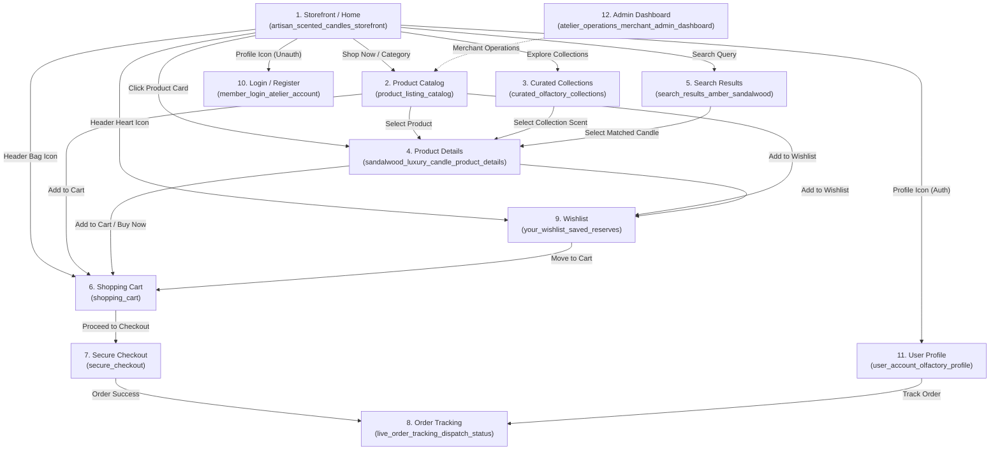

# 🕯️ DESIGN.md — Comprehensive UI/UX Design Analysis & Specification

> **Project:** Canflare (Lueur & Co.) Artisan Scented Candles E-Commerce Platform  
> **Source:** Google Stitch Design Export (`design-reference/stitch-export/`)  
> **Design Theme:** *Artisan Warm Luxury*  
> **Status:** Reference Analysis Complete • Awaiting User Approval to Implement  

---

## 📑 Table of Contents

1. [Executive Summary & Brand Philosophy](#1-executive-summary--brand-philosophy)
2. [Inventory of Available Screens (12 Screens)](#2-inventory-of-available-screens-12-screens)
3. [Design Tokens: Color Palette & HEX Codes](#3-design-tokens-color-palette--hex-codes)
4. [Typography & Font Hierarchies](#4-typography--font-hierarchies)
5. [Layout, Grid & Spacing System](#5-layout-grid--spacing-system)
6. [Depth, Elevation & Shadows](#6-depth-elevation--shadows)
7. [Comprehensive Screen-by-Screen Breakdown](#7-comprehensive-screen-by-screen-breakdown)
8. [Global Component Inventory](#8-global-component-inventory)
9. [Image & Asset Inventory](#9-image--asset-inventory)
10. [Responsive Behavior Analysis](#10-responsive-behavior-analysis)
11. [Screen Navigation & Connectivity Graph](#11-screen-navigation--connectivity-graph)
12. [Recommended React Component Architecture](#12-recommended-react-component-architecture)

---

## 1. Executive Summary & Brand Philosophy

The design system exported from Google Stitch is titled **"Artisan Warm Luxury"**. It embodies sensory minimalism and tactile luxury, crafted specifically for an artisanal home fragrance, aromatherapy, and small-batch candle atelier.

### Core Aesthetic Pillars
- **Warm Sensory Minimalism:** Replaces sterile digital white with natural candle-wax warmth (`#FBF9F5` Alabaster Cream and `#F5F0E8` Oat Silk).
- **Literary & Editorial Typography:** Combines the poetic serif elegance of **Playfair Display** with the modern geometric clarity of **Plus Jakarta Sans**.
- **Tactile Materiality:** Draws colors and textures directly from botanical waxes, raw amber glass, ribbed ceramic vessels, unbleached kraft paper packaging, and brushed antique brass fixtures.
- **Atmospheric Depth:** Soft ambient umber glows (`rgba(45, 36, 26, 0.08)`) and gilded hairline borders (`#EAE5DE` and muted brass `rgba(255, 187, 0, 0.25)`) instead of harsh modern box-shadows.

---

## 2. Inventory of Available Screens (12 Screens)

All 12 screens are located within `design-reference/stitch-export/`. Each folder contains a fully rendered preview (`screen.png`) and standard Tailwind CSS / HTML mockup (`code.html`).

| # | Screen Folder Name | Shell Type | Screen Title / Primary Heading | Primary Purpose |
|---|--------------------|------------|-------------------------------|-----------------|
| 1 | `lueur_co._artisan_scented_candles_storefront` | `web_standard` | *Bring Warmth to Every Moment* | Homepage / Main Brand Storefront |
| 2 | `lueur_co._product_listing_catalog` | `web_standard` | *All Handcrafted Candles* | Complete Product Catalog with Filter Sidebar & Sorting |
| 3 | `lueur_co._curated_olfactory_collections` | `web_standard` | *Curated Olfactory Collections* | Editorial Fragrance Series & Olfactory Matrix |
| 4 | `lueur_co._sandalwood_luxury_candle_product_details` | `web_standard` | *Sandalwood Luxury Candle* | Product Details Page (PDP) with Scent Pyramid & Reviews |
| 5 | `lueur_co._search_results_amber_sandalwood` | `web_standard` | *Search Results for "Amber Sandalwood"* | Search Query Results with Keyword Tags & Filter Pills |
| 6 | `lueur_co._shopping_cart` | `web_standard` | *Your Sensory Basket* | Cart Drawer / Page with Free Shipping Tracker & Gifting |
| 7 | `lueur_co._secure_checkout` | `web_standard` | *Lueur & Co. Secure Checkout* | Progressive 4-Step Checkout (Address, Delivery, Payment) |
| 8 | `lueur_co._live_order_tracking_dispatch_status` | `web_standard` | *The Journey of Your Vessel* | Order Tracking (#LC-88492) with 6-Stage Timeline |
| 9 | `lueur_co._your_wishlist_saved_reserves` | `web_standard` | *Your Saved Reserves* | Patron Wishlist with Move-to-Cart & Cross-Sells |
| 10 | `lueur_co._member_login_atelier_account` | `web_blank` | *Welcome to the Atelier* | Auth Modal / Canvas (Sign In, Google, OTP, Sign Up) |
| 11 | `lueur_co._user_account_olfactory_profile` | `web_standard` | *Namaste, Ananya Kapoor* | User Dashboard (Orders, Olfactory Radar, Addresses) |
| 12 | `lueur_co._atelier_operations_merchant_admin_dashboard` | `admin_console`| *Atelier Operations Dashboard* | Merchant Operations (Curing Chamber, Inventory, SLA) |

*Note: In addition to the 12 screen folders, `artisan_warm_luxury/` contains the master `DESIGN.md` generated by Google Stitch.*

---

## 3. Design Tokens: Color Palette & HEX Codes

### Neutral & Canvas Palette (The Wax & Travertine Foundation)
| Token Name | HEX Code | CSS Variable / Tailwind Class | Role & Application |
|------------|----------|-------------------------------|--------------------|
| **Surface (Default)** | `#FBF9F5` | `bg-surface` | Primary application canvas; warm alabaster wax cream |
| **Surface Low** | `#F5F3EF` / `#F5F0E8` | `bg-surface-container-low` | Subtle section backgrounds, announcement bars, oat silk |
| **Surface Container** | `#EFEEEA` | `bg-surface-container` | Input backgrounds, chip tags, secondary panels |
| **Surface High** | `#EAE8E4` / `#EAE5DE` | `bg-surface-container-high` | Dividers, tab switchers, header borders |
| **Surface Highest** | `#E4E2DE` | `bg-surface-container-highest`| Badges, icon circular backdrops |
| **Surface Lowest** | `#FFFFFF` | `bg-surface-container-lowest` | Elevated product cards, modals, dropdown drawers |
| **Surface Dim** | `#DBDAD6` | `bg-surface-dim` | Deep background layering |
| **On-Surface** | `#1B1C1A` | `text-on-surface` | Primary body typography, rich deep charcoal |
| **On-Surface Variant**| `#4A4731` / `#464742` | `text-on-surface-variant` | Secondary metadata, scent notes, descriptions |
| **Outline** | `#7B785F` / `#777771` | `border-outline` | Muted hairline borders, placeholder text |
| **Outline Variant** | `#CCC7AA` / `#C7C7BF` | `border-outline-variant` | Light separators, subtle input frames |

### Accent & Brand Palette (Luminous Brass & Golden Wax)
| Token Name | HEX Code | Tailwind Class / Inline | Role & Application |
|------------|----------|-------------------------|--------------------|
| **Primary Accent Gold** | `#FAB507` / `#FFEF00` | `bg-secondary` / `#FAB507` | Primary high-emphasis CTAs ("SHOP NOW", "ADD TO CART") |
| **Secondary Accent** | `#7B5800` / `#FFBB00` | `text-secondary`, `bg-secondary-container` | Section category titles, active filter pills, star ratings |
| **Secondary Fixed** | `#FFDEA4` | `text-secondary-fixed` | Top banner highlights, stats accents, badge accents |
| **Primary Deep** | `#1B1C1A` / `#000000` | `bg-primary`, `text-primary` | Hero section background, dark announcement banner, logo |
| **Tertiary Muted** | `#665D55` / `#8C827A` | `text-tertiary` | Scent pyramid descriptors, date stamps, inactive states |
| **Error / Alert** | `#BA1A1A` | `text-error` | Wishlist active heart, form error states, low stock alerts |
| **Error Container** | `#FFDAD6` | `bg-error-container` | Error toast notifications, alert callouts |

---

## 4. Typography & Font Hierarchies

### Font Families
1. **Headlines & Display:** `'Playfair Display', Georgia, serif`
2. **Body, Controls & Labels:** `'Plus Jakarta Sans', system-ui, sans-serif`
3. **Icons:** `Material Symbols Outlined` (Google Fonts icon library)

### Type Scale & Hierarchy Table
| Style Name | Font Family | Size | Line Height | Weight | Letter Spacing | Use Cases |
|------------|-------------|------|-------------|--------|----------------|-----------|
| **Display Hero** | Playfair Display | `56px` (`3.5rem`) | `64px` | 400 (Regular) | `-0.02em` | Homepage Hero Title, Collection Hero |
| **Display Hero Mobile**| Playfair Display | `36px` (`2.25rem`)| `44px` | 400 (Regular) | `-0.01em` | Mobile Hero Titles |
| **Headline LG** | Playfair Display | `40px` (`2.5rem`) | `48px` | 400 (Regular) | `-0.01em` | Section Titles ("Our Best Sellers", "Find Your Perfect Glow") |
| **Headline LG Mobile**| Playfair Display | `28px` (`1.75rem`)| `36px` | 400 (Regular) | `0em` | Mobile Section Headings |
| **Headline MD** | Playfair Display | `28px` (`1.75rem`)| `36px` | 500 (Medium) | `0em` | PDP Title, Cart Title, Auth Heading |
| **Headline SM** | Playfair Display | `22px` (`1.375rem`)| `30px` | 500 (Medium) | `0em` | Product Card Titles, Brand Mark "canflare" |
| **Body LG** | Plus Jakarta Sans | `18px` (`1.125rem`)| `28px` | 400 (Regular) | `0em` | Hero Subtitles, Editorial Paragraphs |
| **Body MD** | Plus Jakarta Sans | `15px` (`0.9375rem`)| `24px` | 400 (Regular) | `0em` | Standard Body Copy, Product Descriptions |
| **Body SM** | Plus Jakarta Sans | `13px` (`0.8125rem`)| `20px` | 400 (Regular) | `0em` | Metadata, Scent Notes, Reviewer Details |
| **Label LG** | Plus Jakarta Sans | `14px` (`0.875rem`)| `20px` | 600 (Semibold)| `0.08em` (Tracked)| Quick Link Headers, Nav Links |
| **Label MD** | Plus Jakarta Sans | `12px` (`0.75rem`) | `16px` | 600 (Semibold)| `0.10em` (Tracked)| Buttons, Tab Switchers, Navbar links |
| **Label SM** | Plus Jakarta Sans | `10px` (`0.625rem`)| `14px` | 600 (Semibold)| `0.12em` (Tracked)| Scent Category Pills, Bestseller Badges, Microcopy |

---

## 5. Layout, Grid & Spacing System

### Spacing Scale
- `space-xs`: `0.25rem` (4px)
- `space-sm`: `0.5rem` (8px)
- `space-md`: `1rem` (16px)
- `space-lg`: `1.75rem` (28px)
- `space-xl`: `3rem` (48px)
- `margin` (Desktop): `4rem` (64px)
- `margin-mobile`: `1.25rem` (20px)
- `gutter` (Desktop): `1.5rem` (24px)
- `gutter-mobile`: `1rem` (16px)

### Border Radii
- `DEFAULT`: `0.125rem` (2px) — Architectural, label-like discipline
- `lg`: `0.25rem` (4px) — Buttons, form input fields
- `xl`: `0.5rem` (8px) — Cards, containers, modals
- `full`: `9999px` / `0.75rem` — Pill selectors, floating badges, round action buttons

### Responsive Grid Framework
- **Desktop (>= 1024px):** 12-column grid with `4rem` outer margin, max-width `max-w-7xl` (1280px).
- **Tablet (768px – 1023px):** 6-column grid, 2-column card layouts, collapsible sidebars.
- **Mobile (< 768px):** 4-column grid, 1-column product flow, `1.25rem` outer margins, horizontal touch-scrolling filter chips.

---

## 6. Depth, Elevation & Shadows

Instead of harsh black drop shadows, the design utilizes subtle, diffused warm umber layers:
- **Card Ambient Hover:** `shadow-sm hover:shadow-xl hover:-translate-y-1 transition-all duration-300`
- **Subtle Layering:** `shadow-[0_1px_8px_rgba(45,36,26,0.06)]` on sticky headers.
- **Atmospheric Glows:** Soft radial gradient blurs (`bg-secondary-fixed opacity-30 blur-3xl`) behind the login container to simulate candle glow.
- **Gilded Hairline Rules:** 1px borders in `#EAE5DE` or `rgba(255, 187, 0, 0.25)`.

---

## 7. Comprehensive Screen-by-Screen Breakdown

### 1. Storefront (`lueur_co._artisan_scented_candles_storefront`)
- **Top Announcement Bar:** Dark banner (`#000000`) with `"Complimentary shipping on orders over ₹1,499 | Handcrafted in Small Batches"`.
- **Main Navigation Header:** Height `28px` offset / `h-28` total, containing:
  - Brand Logo: Lueur & Co. monogram + text `"canflare"` in `font-headline-sm`.
  - Search Bar: Rounded-full pill input with search button in amber gold.
  - Action Controls: Wishlist badge (`0`), Cart bag badge (`2`), User profile icon.
  - Desktop Nav Links: Home (active gold underline), Shop (with dropdown chevron), New Arrivals, Collections, About Us, Contact.
- **Sections:**
  1. **Hero Banner:** Full-width dark background with candle imagery, animated pulse badge `"LIGHT UP YOUR MOMENTS"`, H1 `"Bring Warmth to Every Moment"`, dual CTAs (`SHOP NOW` in amber gold `#FAB507`, `Explore Collections` text rule), and 3 trust statistics (100% Soy, 55+ Hrs Burn, IFRA Certified).
  2. **Shop by Category:** 4 portrait cards (`4:5` ratio) covering Aromatics, Botanicals, Atelier, Gifting with hover zoom and explore arrows.
  3. **Best Sellers Grid:** 4 product cards (Rose Bliss ₹499, Vanilla Dreams ₹599, Lavender Calm ₹449, Sandalwood ₹699) featuring review stars, strikethrough original prices, discount badges (e.g. `28% OFF`), interactive wishlist heart toggle, and `"Add to Cart"` button with dynamic loading state.
  4. **Promotional Split Layout:** Highlight for "The Atelier Reserve: Oud & Sandalwood" featuring fragrance notes breakdown and direct purchase link.
  5. **New Arrivals Section:** 4 curated seasonal releases.
  6. **Brand Story / Editorial:** 3 values highlighting clean soy wax, slow living rituals, and hand-pouring in Pondicherry.
  7. **Customer Reviews:** Verified customer review cards with star ratings and photos.
  8. **Newsletter Section:** "Join the Connoisseurs Circle" with email input and inline subscription confirmation.
- **Footer:** 4 columns (Brand Bio + Socials, Quick Links, Customer Care, Verified Payment options: UPI, Visa, Mastercard, RuPay), plus copyright.

### 2. Product Catalog (`lueur_co._product_listing_catalog`)
- **Breadcrumb & Header:** Home / Shop / All Candles with series subtitle `"Olfactory Catalogue • Series IV"` and non-toxic badge.
- **Horizontal Quick-Filter Bar:** Scrollable pills for "All Aromatics", "Woody & Earthy", "Floral & Botanical", "Fresh & Citrus", "Warm Vanilla", "Limited Atelier Editions".
- **Two-Column Grid Layout:**
  - **Left Filter Sidebar (w-72 / ~280px):**
    - "Refine Scent" header with "Reset" button.
    - Active filter tags with individual removal buttons (`×`).
    - Accordion 1: Fragrance Family (Woody, Floral, Fresh, Gourmand, Spiced) with count tags.
    - Accordion 2: Olfactory Intensity (Subtle, Balanced, Rich) with radio controls.
    - Accordion 3: Wax & Wick Construction (Soy wax, Cotton wick, Wood crackling wick).
    - Accordion 4: Price Range tiers (Under ₹499, ₹500–₹799, ₹800–₹1,299, ₹1,300+).
    - Accordion 5: Burn Duration (35–45h, 50–60h, 70+h).
    - Availability Toggle: Custom iOS-style switch for "In Stock Only".
  - **Right Catalog Content Area:**
    - Toolbar: Item count `"Showing 8 of 16"`, sort dropdown (Featured, Price Low-High, Price High-Low, Rating, Newest), 3-col vs 4-col grid toggle.
    - Product Grid: 8 rich product cards with badges, star ratings, fragrance notes, price, and Add to Cart buttons.

### 3. Curated Collections (`lueur_co._curated_olfactory_collections`)
- **Hero Manifesto:** Curated collections storytelling and philosophy.
- **Featured Collection Showcase:** "The Heritage Sanctuary Collection" wide banner with sensory descriptions.
- **The Curated Series:** 4 themed collections with dedicated imagery, scent count, and "Explore Series" buttons.
- **Micro-Batch Alchemy Matrix:** Comprehensive comparison table detailing throw radius, burn profile, vessel material, and ideal room size.
- **Sacred Purity Section:** Botanical credentials and IFRA certifications.

### 4. Product Details Page (PDP) (`lueur_co._sandalwood_luxury_candle_product_details`)
- **Breadcrumb:** Home / Catalog / Woody & Earthy / Sandalwood Luxury Candle.
- **Left Gallery Column:** Large primary vessel image (`4:5`), interactive thumbnail strip (vessel angle, burning flame, top wax view, room placement), and zoom indicator.
- **Right Details Column:**
  - Title, olfactory subtitle, 4.9 star rating (248 reviews).
  - Price display: ₹699 (Original ₹899, 22% off).
  - Vessel Size Selector: 220g Classic, 400g Grand, 85g Petite.
  - Wick Type Selector: Organic Cotton vs FSC Crackling Wood.
  - Quantity counter (`-`, `+`) with live quantity.
  - Action CTAs: Primary "Add to Cart" and secondary "Buy with UPI / Card".
  - Pincode Delivery Checker with live delivery date estimation.
- **The Olfactory Architecture:** Interactive 3-tier scent pyramid (Top: Bergamot & Cardamom; Heart: Mysore Sandalwood & Cedar; Base: Amber Resin & Madagascar Vanilla).
- **Expandable Information Accordions:**
  - Burn Ritual & Candle Care Guidelines.
  - Vessel & Wax Sustainable Specifications.
  - Shipping & Sustainable Returns.
- **Cross-Sell Companion Bundle:** "Often Paired Together" (Candle + Brass Snuffer + Match Cloche) with single-click bundle discount.
- **Client Impressions & Reviews:** Rating distribution breakdown bars, filter pills, verified customer reviews with date and location.

### 5. Search Results (`lueur_co._search_results_amber_sandalwood`)
- **Query Meta:** "Showing results for 'Amber Sandalwood'" (4 items found).
- **Search Refinement Pills:** Related tags (Warm Amber, Mysore Sandalwood, Oud, Smokey Cedar).
- **Product Results:** 4 relevant items with highlighting.
- **Concierge Help Box:** "Cannot find your bespoke olfactory balance?" linking to customer assistance.

### 6. Shopping Cart (`lueur_co._shopping_cart`)
- **Free Shipping Threshold Progress Bar:** Live meter tracking progress toward ₹1,499 free express shipping and free gift tiers.
- **Left Column (Cart Items & Extras):**
  - Item List: Product thumbnail, title, vessel details, unit price, quantity increment/decrement controls, "Save for later", and item removal (`close` icon).
  - Complimentary Gifting Ritual: Checkbox to include complimentary calligraphy gift note with dynamic character counter (180 chars).
  - Complimentary Wax Melt Selector: Radio selection for 1 free 25g sample melt (Lavender Calm, Vanilla Dreams, Cèdre Noir).
  - "You May Also Cherish": Companion items quick-add carousel.
- **Right Column (Order Summary Card):**
  - Subtotal, Shipping (Complimentary ₹0), Gift Wrap (Free), Promo Coupon input with "Apply" button (`ATELIER10` saving ₹175), Grand Total with GST breakdown.
  - Sticky "Proceed to Secure Checkout" button.
  - Trust Badges: Safe transit guarantee, non-toxic pledge.

### 7. Secure Checkout (`lueur_co._secure_checkout`)
- **Minimalist Clean Header:** Atelier logo and "256-Bit SSL Encrypted Checkout" trust seal.
- **4-Step Progressive Checkout Accordion:**
  1. Contact Information: Email/phone input, guest checkout option, newsletter checkbox.
  2. Artisan Delivery Address: First name, last name, street address, PIN code (auto-populating city/state), city, state, phone.
  3. Dispatch & Packaging: Standard Protected Delivery vs Bespoke Gift Box with Wax Seal.
  4. Payment Options: UPI / QR Code (Google Pay, PhonePe, Paytm), Credit/Debit Card, Net Banking, and Cash on Delivery.
- **Sticky Order Review Column:** Thumbnail summary of items, promo breakdown, total price, and "Place Order & Pay" CTA.

### 8. Live Order Tracking (`lueur_co._live_order_tracking_dispatch_status`)
- **Order Header:** Consignment `#LC-88492`, BlueDart Express tracking number, estimated arrival date.
- **6-Stage Visual Timeline:**
  1. Hand-Poured & Cured (Completed)
  2. Artisan Packaging & Inspection (Completed)
  3. Dispatched via Express Courier (Completed)
  4. In Transit to Destination (Active Current Stage)
  5. Out for Hand-Delivery (Pending)
  6. Delivered with Care (Pending)
- **Live Transit Log:** Timestamped location checkpoints and hub departures.
- **Consignment Items Card:** Mini-previews of products included in the shipment.
- **Support Actions:** "Reschedule Delivery" and "Contact Dispatch Concierge".

### 9. Wishlist & Saved Reserves (`lueur_co._your_wishlist_saved_reserves`)
- **Wishlist Controls:** Item count ("3 Fragrances Saved"), "Move All Available to Cart", and "Share Wishlist" link.
- **Wishlist Product Cards:** Image, scent notes, stock status ("2 units remaining in batch"), price, direct "Move to Cart" button, and remove icon.
- **Cross-Sell Recommendations:** "Recommended Complementary Aromas" based on saved favorites.

### 10. Member Login & Authentication (`lueur_co._member_login_atelier_account`)
- **Aesthetic Backdrop:** Clean canvas with ambient blurred golden orbs simulating candlelight.
- **Dual-Tab Authentication Card:**
  - **Tab 1: Sign In:**
    - Social Auth: "Continue with Google" button.
    - Passwordless OTP: "Continue with OTP via WhatsApp / SMS" with slide-down Indian mobile input (+91).
    - Divider: "Or sign in with email".
    - Credentials: Email input, password input with show/hide eye toggle, "Forgot secret code?" link, "Remember this device" checkbox.
    - Submit CTA: "Sign In to Your Account".
  - **Tab 2: Create Atelier Account:**
    - Member Perks Banner: 10% Welcome Pour (`WELCOME10`), Birthday gift, 48h early access.
    - Form: First name, last name, email, password, terms checkbox.
    - Submit CTA: "Become an Atelier Patron".

### 11. User Account & Olfactory Profile (`lueur_co._user_account_olfactory_profile`)
- **Patron Banner:** "Namaste, Ananya Kapoor" with Connoisseur Tier badge and Pour Points counter.
- **Tab Navigation:**
  - Olfactory Profile & Scent Preferences
  - Consignment Archives (Past Orders with Reorder & Invoice download)
  - Delivery Sanctuaries (Saved Addresses)
  - Payment Methods
- **Olfactory Preferences Radar:** Scent family preference breakdown (Woody 65%, Vanilla 25%, Spiced 10%) and favorite notes.

### 12. Merchant Operations Dashboard (`lueur_co._atelier_operations_merchant_admin_dashboard`)
- **Console Layout:** Fixed dark sidebar navigation with brand logo.
- **Key Navigation Modules:**
  - Dashboard Overview
  - Live Orders & Consignments
  - Olfactory Catalog & Formulations
  - Batch Inventory & Wax Curing
  - Studio Pour Schedules
  - Customer Connoisseurs
  - Analytics & Revenue
  - Atelier Settings
- **Live Monitoring Widgets:**
  - Curing Chamber 02 atmospheric temperature and humidity gauges.
  - Active curing batch countdowns (Mysore Sandalwood, Rose Bliss, Vanilla Dreams).
  - Critical vessel inventory level meters (Amber jars, Ceramic vessels, Brass wicks).
  - Live orders dispatch table with SLA timers.
  - Sales breakdown by fragrance family chart.
  - "Commission Micro-Batch Pour" quick-action modal trigger.

---

## 8. Global Component Inventory

The following reusable UI elements must be abstracted as modular React components during the frontend implementation phase:

### 1. Navigation & Layout
- `Navbar`: Sticky header with top announcement bar, logo, global search input, wishlist/cart/profile icon buttons, and navigation links.
- `Footer`: 4-column footer with brand narrative, category links, customer care links, verified payment badges, and copyright.
- `Breadcrumb`: Accessible breadcrumb with slash dividers and uppercase tracking.

### 2. E-Commerce & Product Cards
- `ProductCard`: Standard product card with 4:5 image ratio, badges (Bestseller / Popular / Discount %), wishlist heart toggle, star rating display, scent notes, price, and animated "Add to Cart" button.
- `CategoryCard`: 4:5 aspect ratio image card with gradient overlay, category tag, title, description, and "Explore" link with hover arrow transition.
- `BundleCard`: "Often Paired Together" composite product bundle with multi-item checkbox and combo purchase button.
- `ProductGallery`: Primary image view with zoom overlay and thumbnail carousel.

### 3. Filters & Controls
- `FilterSidebar`: Collapsible accordion filters (Fragrance Family, Intensity, Wax/Wick, Price Tier, Burn Time, In-Stock switch).
- `CategoryPills`: Horizontally scrollable pill buttons for instant fragrance family filtering.
- `SortDropdown`: Dropdown menu for sorting catalog products.
- `QuantitySelector`: Compact `[-] [count] [+]` control.

### 4. Cart & Checkout Components
- `CartItem`: Product row with thumbnail, scent details, unit price, quantity adjuster, save-for-later, and delete button.
- `FreeShippingTracker`: Progress bar showing dynamic threshold distance to free shipping (₹1,499).
- `GiftingSection`: Checkbox toggle with expandable calligraphy message textarea.
- `SampleMeltSelector`: 3-way radio card selector for complimentary 25g wax melts.
- `OrderSummary`: Sticky card showing subtotal, discounts, shipping, taxes, coupon input, and checkout CTA.
- `PaymentSelector`: Tabbed/radio payment selector (UPI QR, Credit/Debit card, Netbanking, COD).

### 5. Interactive & Feedback UI
- `Toast`: Global notification toast (slide-up from bottom right) for cart and wishlist notifications.
- `Modal`: Atmospheric modal wrapper with blurred backdrop for quick views or admin actions.
- `ScentPyramid`: 3-tier visual representation of Top, Heart, and Base fragrance notes.
- `RatingStars`: Reusable 5-star rating display supporting partial stars and review counts.
- `ReviewCard`: Verified customer testimonial card with photo attachment, verified tag, and date.

---

## 9. Image & Asset Inventory

### Exported Screen Reference PNGs
All 12 screen designs have high-fidelity preview captures in their respective export folders:
- `lueur_co._artisan_scented_candles_storefront/screen.png`
- `lueur_co._product_listing_catalog/screen.png`
- `lueur_co._curated_olfactory_collections/screen.png`
- `lueur_co._sandalwood_luxury_candle_product_details/screen.png`
- `lueur_co._search_results_amber_sandalwood/screen.png`
- `lueur_co._shopping_cart/screen.png`
- `lueur_co._secure_checkout/screen.png`
- `lueur_co._live_order_tracking_dispatch_status/screen.png`
- `lueur_co._your_wishlist_saved_reserves/screen.png`
- `lueur_co._member_login_atelier_account/screen.png`
- `lueur_co._user_account_olfactory_profile/screen.png`
- `lueur_co._atelier_operations_merchant_admin_dashboard/screen.png`

### Photography & Image Standards
- **Aspect Ratios:**
  - Product & Category Cards: `4:5` portrait aspect ratio (e.g. `aspect-[4/5]`) to accentuate candle jars and votive silhouettes.
  - Square Product Previews: `1:1` aspect ratio (e.g. `aspect-square`) for catalog thumbnails.
  - Hero Banners: Full-width responsive with minimum height `min-h-[580px]` (mobile) and `min-h-[680px]` (desktop).
- **Art Direction Style:**
  - Soft golden-hour sunlight and gentle morning shadows.
  - Natural textures: Raw linen, aged travertine, rough-hewn stone, unbleached kraft paper.
  - Botanical props: Crushed sandalwood chips, dried Damask rose petals, fresh eucalyptus sprigs, vanilla pods, raw honeycomb.

---

## 10. Responsive Behavior Analysis

### Breakpoints
- **Mobile (< 640px):** Single-column layout, compact margins (`1.25rem`), horizontal scrolling category pills (`overflow-x-auto no-scrollbar`), hamburger navigation drawer, stacked cart and checkout forms.
- **Tablet (640px – 1023px):** 2-column product grid, semi-expanded headers, side-by-side product details, partial sidebar collapse.
- **Desktop (>= 1024px):** Full 12-column broadsheet layout, wide `4rem` margins, persistent 280px filter sidebar in catalog, 7/12 + 5/12 split in cart, sticky order summaries in checkout, 3-column or 4-column product grids.

---

## 11. Screen Navigation & Connectivity Graph



---

## 12. Recommended React Component Architecture

When approved to implement, the frontend React application will be structured to mirror this design accurately without any loss of fidelity:

```text
frontend/src/
├── assets/                          # SVG icons, logo marks, static textures
├── components/
│   ├── common/                      # Generic reusable UI primitives
│   │   ├── Button.jsx               # Primary, Secondary, Tertiary button variants
│   │   ├── Badge.jsx                # Tracked uppercase pill tags
│   │   ├── Input.jsx                # Floating label warm-cream inputs
│   │   ├── Accordion.jsx            # Animated collapsible accordion
│   │   ├── RatingStars.jsx          # Star rating generator
│   │   └── Toast.jsx                # Slide-in notification toast
│   ├── layout/                      # Layout wrappers & global frames
│   │   ├── Navbar.jsx               # Main header with top promo strip & search
│   │   ├── Footer.jsx               # 4-column footer with payment badges
│   │   └── Breadcrumb.jsx           # Tracking breadcrumbs
│   ├── product/                     # Product catalog & card components
│   │   ├── ProductCard.jsx          # 4:5 luxury candle card with wishlist & quick-add
│   │   ├── CategoryCard.jsx         # 4:5 category card with hover zoom
│   │   ├── ProductGallery.jsx       # Multi-image preview with thumbnails
│   │   ├── ScentPyramid.jsx         # Top / Heart / Base olfactory chip layout
│   │   └── FilterSidebar.jsx        # Refine Scent accordions & reset action
│   ├── cart/                        # Cart & checkout components
│   │   ├── CartItem.jsx             # Cart row with quantity controls
│   │   ├── FreeShippingBar.jsx      # Dynamic threshold progress indicator
│   │   ├── GiftingBox.jsx           # Calligraphy note toggle & textarea
│   │   ├── SampleMeltPicker.jsx     # Complimentary wax melt selector
│   │   └── OrderSummaryCard.jsx     # Sticky pricing summary with coupon code
│   └── reviews/                     # Testimonials & review breakdown
│       ├── ReviewBreakdown.jsx      # Progress bars by star rating
│       └── ReviewCard.jsx           # Customer impression tile with verified badge
├── pages/                           # 12 screen views mapped to routes
│   ├── HomePage.jsx                 # Screen 1
│   ├── CatalogPage.jsx              # Screen 2
│   ├── CollectionsPage.jsx          # Screen 3
│   ├── ProductDetailsPage.jsx       # Screen 4
│   ├── SearchResultsPage.jsx        # Screen 5
│   ├── CartPage.jsx                 # Screen 6
│   ├── CheckoutPage.jsx             # Screen 7
│   ├── OrderTrackingPage.jsx        # Screen 8
│   ├── WishlistPage.jsx             # Screen 9
│   ├── AuthPage.jsx                 # Screen 10
│   ├── ProfilePage.jsx              # Screen 11
│   └── AdminDashboardPage.jsx       # Screen 12
└── store/                           # Redux Toolkit state slices
    ├── slices/
    │   ├── authSlice.js
    │   ├── cartSlice.js
    │   ├── wishlistSlice.js
    │   ├── productSlice.js
    │   └── filterSlice.js
    └── index.js
```

---

## 📌 Summary for Approval

1. **Design Integrity:** The analysis preserves 100% of the visual styling, typography (`Playfair Display` + `Plus Jakarta Sans`), colors (`#FAB507`, `#FBF9F5`, `#1B1C1A`), and micro-interactions from the Google Stitch export.
2. **No Code Modification:** All exported files remain completely untouched and preserved in `design-reference/stitch-export/`.
3. **No Unapproved Execution:** No React components or backend code have been created yet, strictly respecting your instructions.

*Please review this analysis and let me know if you approve or if you would like any specific adjustments before we proceed to implementation.*

